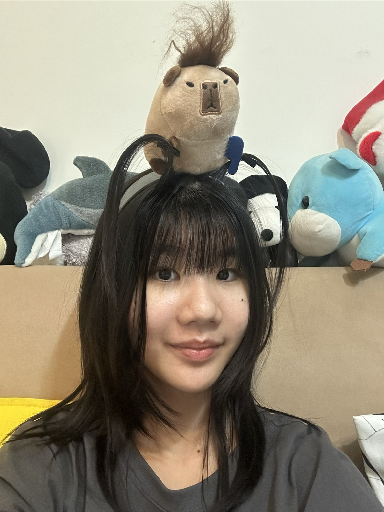
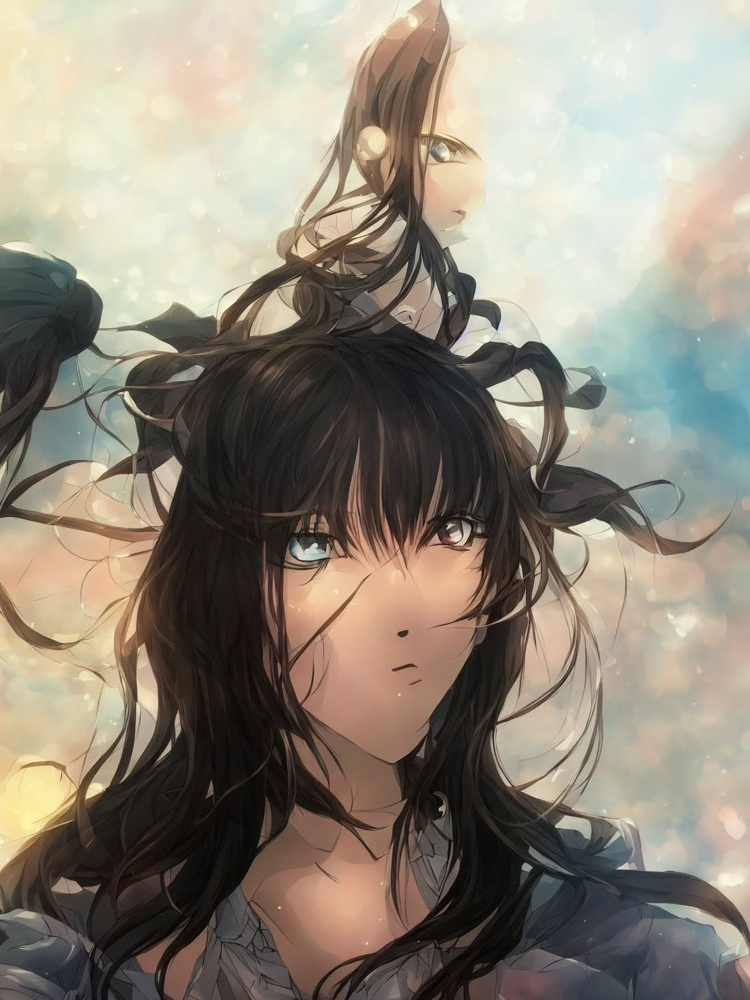
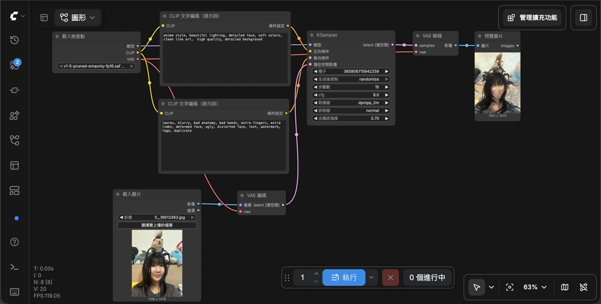

## 1. 原圖

## 2. 生成的圖

## 3. 完整工作流程截圖

## 4. 正向提示詞
anime style,beautiful lighting,clean Line,art,detailed face, soft colors,high quality, detailed background

## 5. 反向提示詞
lowres, blurry, bad anatomy,bao nanes.extra Tingers,extra Limbs,deformed face, ugly, distorted face, text, watermark,logo,duplicat

## 6. 個人心得
用出來的照片和想像中的不依樣，看起來很奇怪，但蠻好玩的